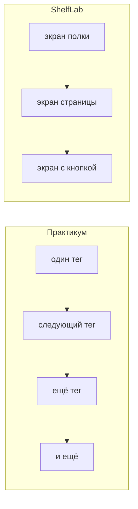

# Зачем нужна эта линейка, если уже есть Практикум

Мы разбирали открытый вводный модуль Практикума: HTML, CSS и JavaScript до урока «Релиз». Для одного человека, который сидит дома и жмёт «далее», он сделан хорошо. Когда тот же материал пытаешься провести в зале за два часа, ритм начинает распадаться.

## Что у Практикума получается сильно

Ученик с первого дня видит, к чему идёт дело. Сначала появляется обложка плейлиста, потом одностраничный сайт, потом небольшое приложение: нажал кнопку и получил совет. Из-за этого сегодняшний тег не висит в воздухе. Он нужен, чтобы на экране стало лучше.

Почти каждый шаг что-то меняет на странице. Человек не слушает длинную лекцию, а делает маленькую правку и сразу видит следствие. Это держит внимание лучше, чем список определений.

Есть живой ритм разговора: короткая сцена, реплика, одно правило, сразу правка. Этот ритм стоит взять в класс. Текст, персонажей и готовые формулировки Практикума копировать не нужно.

Порог входа низкий. Курс не требует выучить весь HTML, прежде чем на экране появится хоть что-то понятное.

## Где это ломается в живом классе

Один клик «далее» в тренажёре занимает у ученика две-четыре минуты. Восемьдесят таких кликов не складываются в одну очную пару. В зале нельзя честно провести день про абзац, следующий день про ссылку и ещё один про атрибут. Класс устаёт от словаря и перестаёт понимать, зачем это его странице. К концу встречи у человека должно быть что показать соседу, а не ещё одна карточка в тренажёре.

```text
один шаг в тренажёре     занимает пару минут
восемьдесят таких шагов  не равны одному уроку на два часа
```

Онлайн прощает несколько вещей, которые в зале сразу становятся проблемой.

Файл стилей появляется поздно, а стили внутри HTML — рано. Дети привыкают писать оформление прямо в разметке и потом с трудом соглашаются вынести его в отдельный файл.

Про коробку элемента — внутренние отступы, рамку, «почему написали 300, а на экране шире» — говорят слишком поздно. Пока группа уже собирает лендинг, ширины плывут, и никто не может объяснить почему.

Нет середины урока, в которой учитель останавливает работу и проверяет, все ли ещё понимают одно и то же. В тренажёре кнопка «далее» сама ведёт вперёд. В зале без такой остановки половина группы уходит в самостоятельную задачу неготовой.

Нет пульта для преподавателя. Есть статьи. Нет понятного ответа, когда смотреть на слайд, когда собирать стенд вместе, когда открывать свои файлы.

JavaScript долго живёт в консоли. После Python это скучно, а до кнопки на странице ещё далеко.



## Рядом с PulseLab, а не вместо него

PulseLab — длинная история: радио, каталог, игра, магазин, сервер. Эту линию мы не трогаем. ShelfLab короче. Это вводная четверть: три законченные вещи на экране и три показа группе. Такой формат удобно пилотировать, сравнивать с Практикумом и вести параллельную группу, которой пока не нужен весь блок A.

PulseLab ведёт по длинной дороге и многим продуктам. ShelfLab делает короткий заход: сначала полка, потом страница, потом кнопка.

## Как мы ведём себя в этой линейке

Каждый урок заканчивается одним экраном, который можно показать соседу.

Сначала класс высказывает догадку, и только потом появляется код. Пока не нажат Enter, руки ещё можно поднять.

Учебный стенд и полка ученика — разные вещи. Со стены копируют приём, а не чужой слоган.

То, без чего ломается вёрстка — связь двух файлов и устройство коробки, — даём до большого лендинга, а не после него, когда чинить уже поздно.

JavaScript появляется, когда на странице нужна живая кнопка, а не как отдельный учебник синтаксиса.

Показ группе — не контрольная. На человека шесть минут и один приём, который он может объяснить своими словами.

## Как восемьдесят уроков стали восемнадцатью

Первые двадцать четыре шага Практикума про HTML и CSS складываются в шесть наших встреч и заканчиваются карточкой полки. Следующие двадцать девять про «больше CSS» и лендинг становятся шестью встречами и одной страницей. Двадцать семь шагов JavaScript сжимаются в шесть встреч и живую кнопку. Урок «что дальше» в отдельный день не выносится: если останется время, это десять минут в конце курса.

Куда лёг каждый номер Практикума, написано в [MAP-FROM-PRACTICUM.md](./MAP-FROM-PRACTICUM.md). Что происходит на каждой встрече — в [CURRICULUM.md](./CURRICULUM.md).
