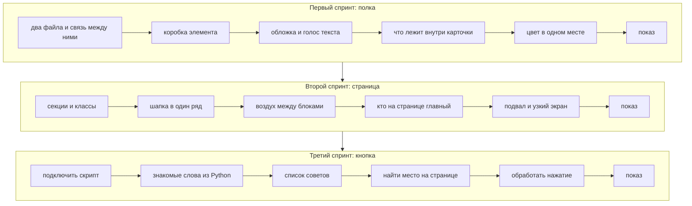

# Сетка из восемнадцати уроков

Курс рассчитан на восемнадцать встреч по два часа. Три спринта по шесть уроков. Показ группе приходится на шестую, двенадцатую и восемнадцатую встречу.

Ученик делает свою полку: своё название, свои тексты. В материалах она называется MyShelf, чтобы всем было понятно, о каком проекте речь. На проекторе учитель собирает учебный стенд WireShelf. С него не копируют названия и формулировки, только способ работы.

## Кто приходит и с чем уходит

На вход достаточно человека, который уже открывал VS Code и Live Server. Python желателен, HTML не обязателен.

На выходе у ученика три вещи: карточка полки, одностраничный сайт и кнопка, которая подставляет новый совет. Плюс три показа группе. Они не обязаны быть идеальными. Они обязаны быть живыми и своими.

Если человек отстаёт, минимум, с которым можно идти дальше, такой: страница связана со стилями, у карточки есть воздух внутри, кнопка реагирует на нажатие.

Если человек быстрый, он добавляет второй визуальный акцент, помогает соседу или кладёт в список ещё один свой совет.

## Первый спринт: карточка

К концу шестой встречи на экране должен быть квадрат, который уже похож на вещь, а не на упражнение: обложка, название, подпись, воздух вокруг текста. Это не набор выученных тегов. Это карточка, которую не стыдно показать.

| День | О чём говорим | Что видно у ученика | Как проверяем середину пары |
| --- | --- | --- | --- |
| S01 | Страница и стиль живут в разных файлах | Тёмный экран, заголовок, подпись | Сняли связь — экран стал белым |
| S02 | Почему «ширина 300» на экране оказывается больше | Карточка с воздухом внутри | Хор считает 344 и 300 |
| S03 | Буквы разной громкости и картинка в рамке | Квадрат без растянутого лица | Человек своими словами отличает cover от contain |
| S04 | Что вкладывается внутрь чего | Обложка и тексты лежат в одной коробке | На схеме показывают, кто родитель |
| S05 | Цвет правится в одном месте, а не на каждом теге | Карточка уже выглядит собранной | Класс знает, где менять акцент |
| S06 | Показ | Шесть минут на человека | На стене видна рубрика |

Намеренно не делаем отдельный день только про тег `style`, отдельный день «вот абзац» без заголовка и не откладываем коробку элемента «на потом, когда будет лендинг».

## Второй спринт: страница

Собираем одну страницу: шапку, первый экран, средний блок и подвал.

| День | О чём говорим | Что видно на экране | Как проверяем |
| --- | --- | --- | --- |
| S07 | Классы и несколько кусков страницы | Секции, а не каша внутри `body` | Назвать вслух два класса |
| S08 | Имя слева, действие справа | Шапка читается как панель, а не как столбик | Угадать `space-between` до того, как применили |
| S09 | Воздух внутри блока и снаружи | Секции не слиплись | Отличить padding от margin |
| S10 | Кто на странице говорит громче | Первый экран читается с двух шагов | Показать, где главный текст |
| S11 | Подвал и узкое окно | Вся страница на месте, без скролла вбок | Проверка на ширине 360 пикселей |
| S12 | Показ | Шесть минут | Один приём CSS своими словами |

Мелочи вроде ещё одной границы или ещё одной тени не размазываем на отдельные дни. Один приём разбираем один раз на стенде и сразу кладём на страницу.

## Третий спринт: кнопка

Появляется страница с кнопкой. По нажатию из списка достаётся другой совет. Список свой, не чужой.

| День | О чём говорим | Что уже работает | Как проверяем |
| --- | --- | --- | --- |
| S13 | Зачем нужен JavaScript и как подключить файл | Скрипт висит на странице | Без подключения ничего не оживает |
| S14 | Это те же мысли, что в Python, только пишутся иначе | Три совета записаны константами | Не тащим `var` только потому, что так выпало в поиске |
| S15 | Список и случайный номер | Функция достаёт один совет | Номер не вылезает за край списка |
| S16 | Найти кусок страницы и подставить в него текст | Совет виден на экране, а не только в консоли | Узел нашёлся |
| S17 | Нажатие вызывает функцию | Кнопка меняет текст | Без JavaScript кнопка — просто картинка |
| S18 | Показ и условный релиз | Клик работает на сцене | Живой, а не на скриншоте |

Отдельные дни про числа, склейку строк и «магию присваивания» не выносим. Это шпаргалка четырнадцатой встречи. Условия, объекты, циклы и внешние библиотеки не держат выпуск: если после показа останется интерес, это хвост либо уже материал PulseLab.

Как пара идёт по минутам, написано в [METHOD.md](./METHOD.md).
