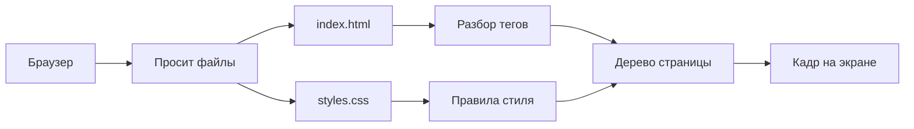

> **На уроке:** [runbook](./runbook.md) · [lecture](./lecture.md) · [slides](./slides.md) · [checks](./checks.md). Это deep-notes для подготовки.
# Урок A01. Первый экран и мгновенный стиль

- Блок: A · обычный · 120 минут
- Стенд: [PulseDeck a01](../demo/)
- Радио: [starter](../student/starter/) → [etalon](../solution/)
- К родителям: баннер Pulse FM (не лаунчер)

## Цель урока

Ученик сам собирает тёмный баннер **Pulse FM** с заголовком, слоганом и кнопкой «Слушать»: два файла (`index.html` + `styles.css`) и рабочий `<link>`. Понимает, зачем контент и стиль разнесены.

## Что видно на двух экранах

| Экран | Продукт | Акцент | Роль |
| --- | --- | --- | --- |
| Проектор | PulseDeck · Night Circuit | зелёный `#2EE6A6` | теория + пример вместе |
| Ноутбук | Pulse FM | фиолетовый `#7C5CFF` | лаборатория |

Тексты Night Circuit / Play в радио **не копировать**.

## Тайминг 120

| Мин | Блок | Преподаватель | Ученики |
| --- | --- | --- | --- |
| 0–10 | Хук | Реплика, F12 на любом сайте | Отвечают |
| 10–28 | Теория + схема | Рисует схему рендера, факт SoC, ловушка | Смотрят, спорят |
| 28–55 | Пример вместе | Скрипт PulseDeck по шагам | Руки на столе, вопросы |
| 55–105 | Лаборатория | Мост, чек-лист, ходит | Своё радио |
| 105–120 | Смотр + ДЗ | Только FM, 2–3 экрана | Пишут ДЗ |

---

## 1. Хук · 0–10 мин

**Показать:** любой знакомый сайт (Discord / Spotify) → F12 → вкладка Elements.

**Сказать:**

> Кто жал F12 не чтобы «взломать», а из любопытства: откуда тёмный фон и огромная кнопка? Сегодня разложим это по полочкам. Сначала соберём учебный лаунчер **вместе** на проекторе. Потом каждый сделает **своё радио** Pulse FM — его вы покажете родителям через пять недель. Лаунчер копировать запрещено: унесёте приём, не чужой бренд.

**Спросить:** «Сайт — это картинка или текст, который браузер рисует?» (навести на «текст + правила стиля»).

---

## 2. Презентация · схема рендера · 10–20 мин

**Вывести на экран / нарисовать на доске:**



**Говорить по стрелкам:**

1. Браузер не «хранит сайт внутри себя» — он **просит файлы** (сейчас с диска, потом с сервера).
2. HTML = список предметов на сцене (заголовок, кнопка).
3. CSS = костюмы и свет.
4. Без стрелки `link` файл CSS лежит мёртвый: дерево есть, кадр «голый».
5. Браузер рисует кадр снова и снова — как игровой движок.

**Мини-схема файлов (написать списком на доске):**

```
pulse-deck/          ← сегодня на проекторе
  index.html
  styles.css

pulse-fm/            ← потом у вас
  index.html
  styles.css
```

---

## 3. Индустрия · Separation of Concerns · 20–24 мин

**Сказать:**

> В командах дизайн и контент живут в разных файлах не «для красоты учителя». Если завтра сменят цвет кнопки во всём продукте, правят **один** CSS, а не сто HTML. Это называется разделение ответственности: HTML отвечает за смысл, CSS — за вид. Смешать всё в `style=""` на каждом теге — как держать весь Python-проект в одном `main` на 500 строк: через месяц никто не найдёт баг.

Тёмные темы Discord/Spotify: меньше спора с обложками, комфорт на OLED. Мы с дня один в той же логике холста.

---

## 4. Аналогия · 24–26 мин

HTML = скелет персонажа. CSS = скин. Браузер = движок. Без скина — «недоделанный персонаж в редакторе».  
Python: забытый `import` модуля = забытый `<link>`.

---

## 5. Вопрос-ловушка · 26–28 мин

> Стили лежат в `styles.css`, но в HTML нет `<link>`. Экран тёмный или белый?

Дать 20–30 сек спора. Ответ: **белый (дефолт браузера)**. Файл, который не подключили, для браузера не существует.

---

## 6. Пример вместе · скрипт PulseDeck · 28–55 мин

**Папка на проекторе:** `../demo/`  
Можно собирать с нуля рядом или открыть эталон и «воспроизвести» шаги вслух.

### Шаг 1 · Показать пустую папку / два файла

1. **Показать:** проводник / VS Code.
2. **Сделать:** создать `index.html`, `styles.css`.
3. **Сказать:** «Два файла с первой минуты. Сцена и свет.»
4. **Спросить:** «Что будет, если всё запихнуть в один HTML?» → поддержку убьём.

### Шаг 2 · Каркас HTML

**Сделать (набрать или подсветить):**

```html
<!DOCTYPE html>
<html lang="ru">
<head>
  <meta charset="UTF-8">
  <meta name="viewport" content="width=device-width, initial-scale=1.0">
  <title>PulseDeck</title>
</head>
<body>
</body>
</html>
```

**Сказать:**  
- `DOCTYPE` — «новый браузер, не режим 1997».  
- `lang="ru"` — язык страницы.  
- `charset` — чтобы не было кракозябр.  
- `viewport` — телефон не сожмёт страницу как плакат.  
- `title` — **вкладка**, не заголовок на экране.

**Спросить:** «title и h1 — одно и то же?» → Нет.

### Шаг 3 · HUD без стилей

```html
<section class="hud">
  <p class="badge">LAUNCHER</p>
  <h1>Night Circuit</h1>
  <p class="sub">Катка начинается с экрана. Это стенд, не радио.</p>
  <a class="play" href="#play">Play</a>
</section>
```

**Показать:** открыть в браузере — уродливый белый лист.  
**Сказать:** «Скелет есть. Скина нет. Так выглядит продукт без CSS.»

### Шаг 4 · Подключить CSS

В `<head>`:

```html
<link rel="stylesheet" href="styles.css">
```

**Сделать:** сохранить, обновить. Пока CSS пустой — всё ещё бледно.  
**Сказать:** «Стрелка на схеме заработала. Теперь наполним свет.»

### Шаг 5 · Базовый CSS

```css
* { box-sizing: border-box; }

body {
  margin: 0;
  min-height: 100vh;
  background: #070b14;
  color: #e8eefc;
  font-family: "Segoe UI", sans-serif;
}
```

**Сказать:**  
- `*` и `border-box` — ремень безопасности (разбор на A02).  
- `100vh` — холст на всю высоту окна.  
- Зелёный бренд лаунчера ≠ фиолетовый бренд радио.

### Шаг 6 · Кнопка и типографика HUD

```css
.hud { padding: 56px 32px; max-width: 640px; }
.badge { letter-spacing: 0.2em; color: #2ee6a6; font-size: 0.75rem; }
h1 { font-size: 2.6rem; margin: 8px 0 12px; }
.sub { color: #8b95ad; margin-bottom: 28px; }
.play {
  display: inline-block;
  background: #2ee6a6;
  color: #070b14;
  padding: 12px 28px;
  border-radius: 8px;
  text-decoration: none;
  font-weight: 700;
}
```

**Показать:** готовый эталон `00-pulsedeck/a01/`.  
**Сделать:** в DevTools → Elements снять галочку с `<link>` или удалить правило `background` — страница «лысеет». Вернуть.  
**Спросить:** «Куда смотреть, если стили не применились?» → Network / путь к файлу.

### Шаг 7 · Итог стенда

**Сказать:** «Лаунчер готов как учебный пример. Сейчас закрываем его ментально. Открываем **своё** радио.»

---

## 7. Мост к лаборатории · 55–58 мин

| На PulseDeck | В Pulse FM |
| --- | --- |
| `title` PulseDeck | `title` Pulse FM |
| Зелёный Play | Фиолетовая «Слушать» `#7c5cff` |
| Фон `#070b14` | Фон `#0b0f1a` (можно тот же тёмный род) |
| Текст Night Circuit | **Свой** слоган |
| Класс `.play` | Класс `.btn` (другие имена — меньше копипаста) |

**Реплика:** «Кто принесёт на смотр зелёный Play и Night Circuit — покажет чужой стенд, не своё радио. Не зачёт лаборатории.»

Раздать/открыть [starter/](../student/starter/).

---

## 8. Лаборатория · 58–105 мин

**Must-have**

1. Папка `pulse-fm/`: `index.html` + `styles.css`.
2. Каркас с `lang`, charset, viewport, title.
3. Рабочий `<link>`.
4. Баннер: лого/лейбл, h1, слоган, кнопка-капсула.
5. Проверка: отключили CSS — страница «лысая».

**Nice-to-have:** второй абзац muted `#9aa3b8`.

**Чёллендж:** `.btn:hover { filter: brightness(1.15); }` — «браузер умеет состояния без JS».

Преподаватель ходит: смотрит вкладку, цвет кнопки, не чужой текст.

---

## 9. Ошибки 12–14 лет

| Симптом | Почему | Фикс за 15 сек |
| --- | --- | --- |
| Файл `index.html.txt` | Скрыты расширения | Включить расширения в проводнике |
| Стили не липнут | Неверный путь / нет link | DevTools → Network → 404 |
| Кракозябры | Нет charset | meta в head |
| Всё в `style=""` | Обход структуры | «Только файл styles.css» |
| Скопирован PulseDeck | Путают стенд и продукт | Переписать тексты и цвет |

---

## 10. Смотр · 105–120 мин

Только Pulse FM. Вопросы залу: «Где link? Где title?»  
ДЗ: [homework.md](homework.md). Эталон радио: [etalon/](../solution/).


