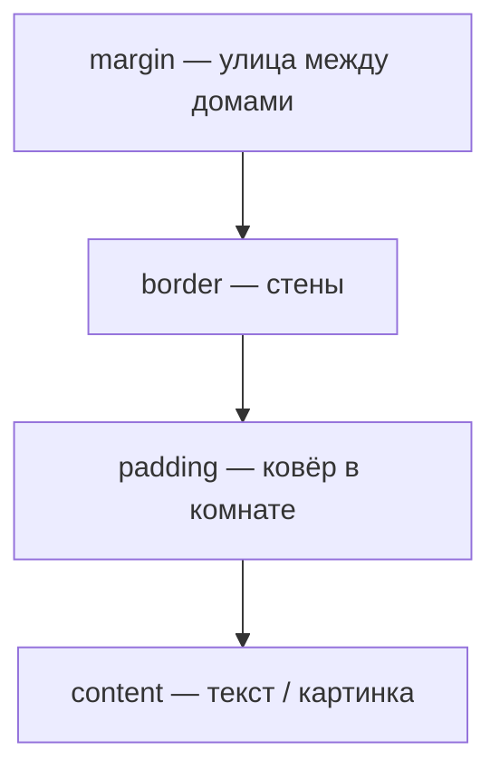

> **На уроке:** [runbook](./runbook.md) · [lecture](./lecture.md) · [slides](./slides.md) · [checks](./checks.md). Это deep-notes для подготовки.
# Урок A02. Box Model — анатомия коробки

- Блок: A · обычный · 120 минут
- Стенд: [PulseDeck a02](../demo/)
- Радио: [starter](../student/starter/) → [etalon](../solution/)

## Цель урока

Ученик объясняет слои content → padding → border → margin, считает ширину на доске и собирает карточку трека с `box-sizing: border-box`.

## Два экрана

| Проектор | Ноутбук |
| --- | --- |
| Карточка **квеста** PulseDeck (зелёная обводка) | Карточка **трека** Pulse FM (фиолетовая/тёмная) |

## Тайминг 120

| Мин | Блок |
| --- | --- |
| 0–10 | Хук: коробка с маркетплейса |
| 10–28 | Схема Box Model + арифметика 300 vs 344 |
| 28–55 | PulseDeck + DevTools Computed |
| 55–105 | Карточка трека в радио |
| 105–120 | Смотр: «воздух есть / нет» |

---

## 1. Хук · 0–10

**Показать:** (можно нарисовать) коробка наушников.

**Сказать:**

> Товар — content. Пузырчатая плёнка внутри — padding. Картон — border. Щель до соседней коробки на полке — margin. Весь CSS-layout крутится вокруг этих четырёх слоёв. Кто не понял коробку, всю жизнь двигает пиксели наугад и орёт «ширина 300, а на экране 340».

**Спросить:** «Padding — внутри рамки или снаружи?» → Внутри.

---

## 2. Презентация · схема коробки · 10–22



**На доске нарисовать пончик** (прямоугольник в прямоугольнике) и подписать слои.

### Арифметика (обязательно хором)

Записать:

`width: 300px`  
`padding: 20px` (слева и справа)  
`border: 2px` (слева и справа)

| Режим | Формула | Итог на экране |
| --- | --- | --- |
| `content-box` (старый сюрприз) | 300 + 20+20 + 2+2 | **344px** |
| `border-box` (прод) | ширина = вся коробка | **300px**, padding ест изнутри |

**Сказать, рисуя:** «border-box = ремень безопасности. Мы уже включили его вчера в `*`. Сегодня поймёте зачем.»

---

## 3. Индустрия · 22–26

**Сказать:**

> В 2000-х IE и другие браузеры считали ширину по-разному. Верстальщики ненавидели «магические 344». Почти любой современный сайт (GitHub, Discord) начинает CSS с:

```css
*, *::before, *::after { box-sizing: border-box; }
```

> Это не школьная прихоть — это договорённость индустрии, чтобы колонки не разъезжались. Баг верстки = деньги на поддержку и злые пользователи.

---

## 4. Аналогия · 26–27

Python: пустые строки *между* функциями = margin; отступ *внутри* `def` = padding.  
Minecraft: хитбокс vs скин. `border-box`: хитбокс = то, что написали в `width`.

---

## 5. Ловушка · 27–28

> Карточка `width: 300`, padding 20+20, border 2+2, `content-box`. Сколько px займёт?

Хор считает → **344**. С `border-box` → **300**.

---

## 6. Пример вместе · PulseDeck + DevTools · 28–55

**Эталон:** `00-pulsedeck/a02/`

### Шаг 1 · Открыть стенд A01 и добавить квест

**Показать:** HUD уже есть.  
**Сделать:** в HTML после HUD:

```html
<article class="quest">
  <h2>Квест: первый вход</h2>
  <p>Награда: 50 XP. Это коробка: внутри воздух, снаружи улица.</p>
</article>
```

**Сказать:** `article` — самостоятельная единица смысла (как объект), не безымянный серый `div`.

### Шаг 2 · CSS коробки

```css
.quest {
  width: 320px;
  margin: 24px 32px 48px;
  padding: 20px;
  border: 2px solid #2ee6a6;
  border-radius: 16px;
  background: #12182a;
}
```

**Сказать:** margin отодвигает от HUD; padding не даёт тексту липнуть к рамке; radius — скругление плитки.

### Шаг 3 · DevTools · обязательно

1. **Сделать:** ПКМ по карточке → Inspect.  
2. **Показать:** вкладка **Computed** / схема box model (пончик).  
3. **Сказать:** «Если пончика не видите — вы гадаете, не дебажите.»  
4. **Сделать:** временно поставить `box-sizing: content-box` на `.quest`, менять padding, смотреть как растёт общая ширина.  
5. **Вернуть** `border-box` на `*` / элементе.  
6. **Спросить:** «Куда делись 40px padding при border-box?» → Съели место у content.

### Шаг 4 · Итог стенда

Зелёная квест-карточка = учебный стенд. В радио будет **трек**, другие цвета и класс `.card`.

---

## 7. Мост

| PulseDeck | Pulse FM |
| --- | --- |
| `.quest` | `.card` |
| Зелёная рамка | `#141a2a` + тонкая граница `#2a3348` |
| Текст про XP | Название трека, исполнитель, время |
| width ~320 | ~280 |

**Реплика:** «Класс `.quest` в радио не тащим. Переименовать = меньше слепого копипаста.»

---

## 8. Лаборатория · 55–105

**Must-have:** баннер A01 жив; одна `article.card`; padding ≥16px; radius; margin от баннера; `*` с border-box не выкинут.

**Nice-to-have:** вторая карточка столбиком (flex-ряд — A04/A05).

**Чёллендж:** `.cover` высотой 120px с градиентом (фото — A03).

---

## 9. Ошибки 12–14

| Симптом | Фикс |
| --- | --- |
| Путают margin/padding | «Улица / ковёр» |
| Горизонтальный скролл | Проверить border-box и width 100% |
| Карточка на весь проектор | Ограничить width 280–320 |
| Border 10px «для красоты» | 1px + контраст фона |
| Скопирован `.quest` | Переименовать в `.card` |

---

## 10. Смотр

Две работы: «текст липнет к краю» vs «есть воздух». Вопрос: «Где padding на пончике?»  
ДЗ: [homework.md](homework.md).


