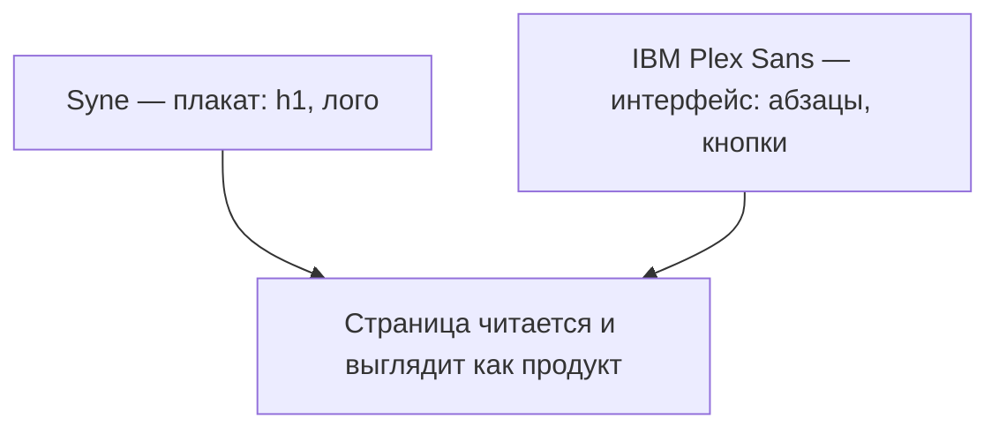
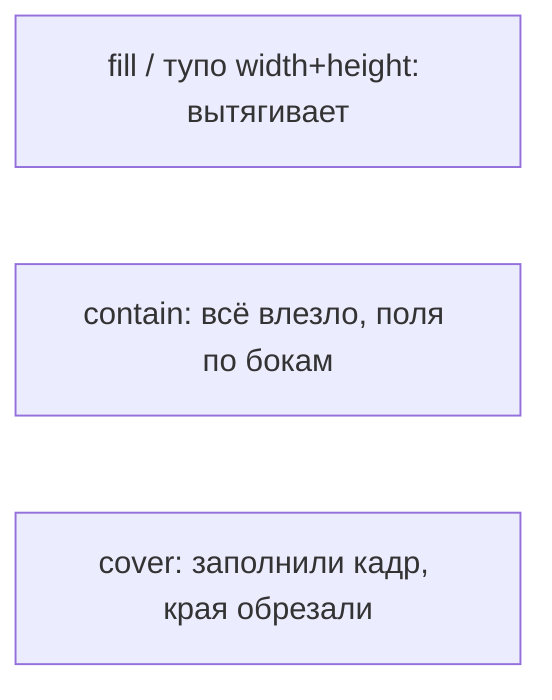

> **На уроке:** [runbook](./runbook.md) · [lecture](./lecture.md) · [slides](./slides.md) · [checks](./checks.md). Это deep-notes для подготовки.
# Урок A03. Типографика, шрифты и обложка

- Блок: A · 120 мин
- Стенд: [PulseDeck a03](../demo/)
- Радио: [starter](../student/starter/) → [etalon](../solution/)

## Цель

Подключает Google Fonts (Syne + IBM Plex Sans), держит иерархию заголовков, ставит квадратную картинку с `object-fit: cover` и осмысленным `alt`.

## Два экрана

| PulseDeck | Pulse FM |
| --- | --- |
| Иконка игры Night Circuit | Обложки **своих** треков (picsum seed / своё фото) |

## Тайминг 120

| Мин | Блок |
| --- | --- |
| 0–10 | Хук: сплющенное лицо на обложке |
| 10–28 | Схемы шрифтов + object-fit |
| 28–55 | Fonts + cover на стенде |
| 55–105 | Обложки в радио |
| 105–120 | Смотр |

---

## 1. Хук · 0–10

**Показать:** заранее подготовленный пример (или быстро в DevTools) — картинка с `width/height` без object-fit, лицо/обложка растянуты.

**Сказать:**

> Плейлисты Spotify — квадраты. Не «как вышло с телефона». Бросили фото 4000×3000 в рамку 200×200 без правил — браузер размажет как жвачку. Сегодня: характер буквами (шрифты) и честная геометрия картинки.

---

## 2. Презентация · 10–22

### Схема A · роли шрифтов



**На доске таблица:**

| Роль | Шрифт | Если нарушить |
| --- | --- | --- |
| Плакат | Syne | Длинный текст Syne — глаза устают |
| UI-текст | Plex | Всё одним шрифтом — «школьный реферат» |

### Схема B · судьба картинки в рамке



**Рисовать три квадрата** и один прямоугольник-фото внутри каждого варианта.

**Сказать:** `cover` = кроп в фоторедакторе. YouTube-превью и аватарки Discord живут на нём. Иначе сетка пляшет.

Дополнительно: `aspect-ratio: 1` держит квадрат, пока файл качается — меньше скачка вёрстки (CLS в проде = метрика качества).

---

## 3. Индустрия · 22–26

**Сказать:**

1. **CDN шрифтов (Google Fonts):** файлы шрифтов весят; их кэшируют и раздают с края сети. На занятии нужен интернет; офлайн — системный fallback (`Segoe UI`, `sans-serif`).
2. **Оптимизация медиа:** ученик тащит 5 МБ с телефона — страница «тупит». Учим сжимать или брать picsum.
3. **`alt` — a11y:** скринридер и случай, когда картинка не загрузилась. Пустой или «image123» — плохой тон в проде и на собесе.

---

## 4. Аналогия · 26–27

Игра: HUD-font vs lore-font.  
Python: `print` vs аккуратный f-string с выравниванием.

---

## 5. Ловушка · 27–28

> `width: 200; height: 200` без object-fit. Лицо вытянется или обрежется?

**Вытянется** (исказится). `cover` — обрежет края, пропорции живы.

---

## 6. Пример вместе · PulseDeck a03 · 28–55

### Шаг 1 · Подключить шрифты

**Показать:** [fonts.google.com](https://fonts.google.com) кратко (Syne, IBM Plex Sans).  
**Сделать:** в head эталона:

```html
<link rel="preconnect" href="https://fonts.googleapis.com">
<link rel="preconnect" href="https://fonts.gstatic.com" crossorigin>
<link href="https://fonts.googleapis.com/css2?family=IBM+Plex+Sans:wght@400;600&family=Syne:wght@700&display=swap" rel="stylesheet">
```

**Сказать:** «Это как `pip install` для букв. `preconnect` — поздороваться с сервером заранее.»  
**Спросить:** «Что если link шрифтов сломан?» → Может поехать весь CSS ниже / останутся fallback.

### Шаг 2 · Назначить семейства

```css
body { font-family: "IBM Plex Sans", sans-serif; line-height: 1.5; }
h1, h2, .badge { font-family: Syne, sans-serif; }
```

Шкала: h1 ~2.4–2.6rem, текст 1rem, line-height 1.5.  
**Сказать:** «Шкала как уровни в RPG, не пять случайных размеров.»

### Шаг 3 · Картинка без cover (плохой кадр)

Вставить img, задать width/height квадрат **без** object-fit, показать искажение.  
**Сказать:** «Запомните боль. Сейчас лечим.»

### Шаг 4 · Лечение

```css
.quest img {
  width: 100%;
  aspect-ratio: 1;
  object-fit: cover;
  border-radius: 12px;
  display: block;
}
```

```html

```

**Сказать:** alt — предложение по смыслу, не `img1`.  
**Показать:** эталон `00-pulsedeck/a03/`.

---

## 7. Мост

| Стенд | Радио |
| --- | --- |
| Иконка Night Circuit | Свой seed / своё учебное фото |
| Зелёный акцент | Палитра FM |
| Квест | Трек: название + исполнитель |

---

## 8. Лаборатория · 55–105

**Must-have:** два семейства; h1 не тем же ритмом, что длинный текст; img + alt; cover + квадрат; карточка A02 жива.

**Nice-to-have:** `letter-spacing` у лого; `figcaption`.

**Чёллендж:** figcaption muted под обложкой.

---

## 9. Ошибки

| Симптом | Фикс |
| --- | --- |
| Битый link fonts | Проверить кавычки и `>` |
| Тяжёлое фото | Сжать / picsum |
| Syne на абзац | Вернуть Plex |
| Нет alt | Дописать смыслом |
| background вместо img на треке | Для контента — `` |

---

## 10. Смотр

Сравнить две обложки: с cover и без (если кто забыл).  
ДЗ: [homework.md](homework.md).


