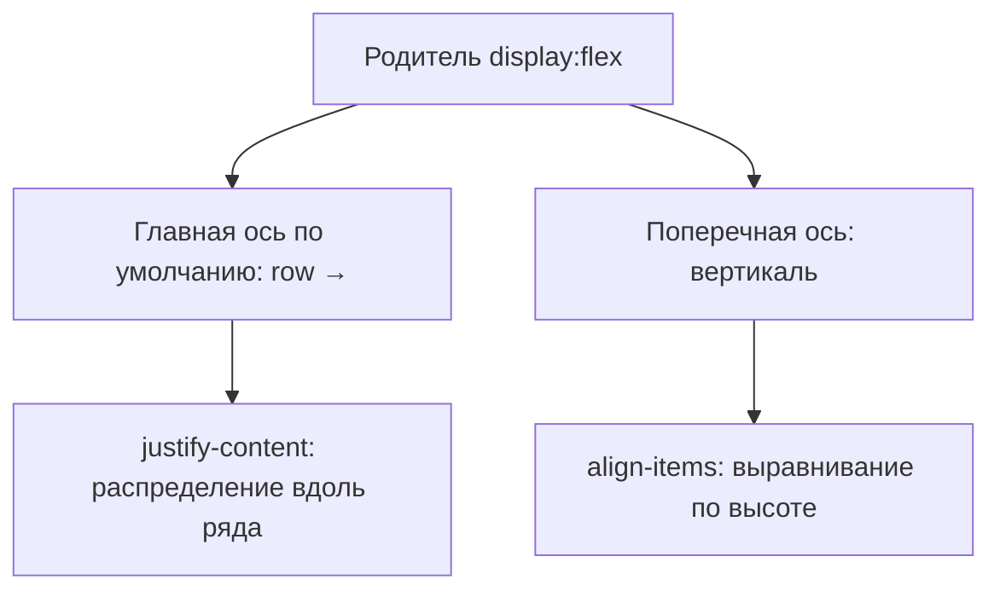

> **На уроке:** [runbook](./runbook.md) · [lecture](./lecture.md) · [slides](./slides.md) · [checks](./checks.md). Это deep-notes для подготовки.
# Урок A04. Flexbox — шапка как зона управления

- Блок: A · 120 мин
- Стенд: [PulseDeck a04](../demo/)
- Радио: [starter](../student/starter/) → [etalon](../solution/)

## Цель

Собирает шапку: бренд слева, меню справа — через `display: flex`, `justify-content`, `align-items`, `gap`. Понимает главную и поперечную оси.

## Два экрана

| PulseDeck | Pulse FM |
| --- | --- |
| Play / Друзья / Магазин | Эфир / Треки / Клуб |

## Тайминг 120

| Мин | Блок |
| --- | --- |
| 0–10 | Хук: зоны HUD в играх |
| 10–28 | Схема осей Flex |
| 28–55 | Бар лаунчера вместе |
| 55–105 | Шапка радио + якоря |
| 105–120 | Смотр |

---

## 1. Хук · 0–10

**Показать:** скрин любой игры / Discord — HP слева, меню справа (или нарисовать зоны).

**Сказать:**

> Глаз выучил зоны. Сайты так же: лого слева, действия справа. Столбик ссылок по центру страницы — не «минимализм», а несобранный инвентарь. Flexbox — честный инструмент «дети в ряд, края к стенкам». Не таблицы. Не float. Не пробелы в HTML.

---

## 2. Презентация · оси · 10–22



**Таблица на доске (с жестами руками — ряд / вверх-вниз):**

| Свойство | Живым языком | Частый выбор сегодня |
| --- | --- | --- |
| `display: flex` | Дети встают в управляемый ряд | на `header` |
| `justify-content: space-between` | Края к стенкам | лого ↔ нав |
| `align-items: center` | На одну полку по вертикали | да |
| `gap` | Воздух между детьми | 16–20px |
| `flex-direction: column` | Столбик | не сегодня в шапке |

**Рисовать:** прямоугольник-родитель, два ребёнка, стрелки main/cross.

Дополнительно: у `nav` тоже может быть `display: flex` + `gap`, чтобы ссылки шли в ряд внутри правой зоны.

---

## 3. Индустрия · 22–26

**Сказать:**

> Раньше шапки собирали на `float: left` и «очистках» `clearfix` — хрупко и больно учить. Flex (и позже Grid) — договорённость браузеров. Шапки Discord, GitHub, Figma в вебе — этот примитив. Вы учите не школьный раритет, а то, чем собирают прод в 2026. Адаптив без боли начнём усиливать на A07, но база осей — сегодня.

---

## 4. Аналогия · 26–27

Python: `print(*items)` в одну строку vs цикл с новой строкой ≈ `row` vs `column`.  
Игра: хотбар — flex-ряд слотов с gap.

---

## 5. Ловушка · 27–28

> Родитель — flex. У одного ребёнка `width: 100%`. Что с соседями?

Жадный ребёнок выталкивает остальных. Сегодня края **не** ставят 100%: два ребёнка (лого и nav), `space-between`.

---

## 6. Пример вместе · PulseDeck a04 · 28–55

### Шаг 1 · Было: столбик

Показать меню ссылок без flex (если нужно — временно убрать flex) — «инвентарь сваленный».

### Шаг 2 · Разметка бара

```html
<header class="bar">
  <p class="mark">PulseDeck</p>
  <nav>
    <a class="on" href="#play">Play</a>
    <a href="#friends">Друзья</a>
    <a href="#shop">Магазин</a>
  </nav>
</header>
```

**Сказать:** `nav` — роль навигации (скринридер скажет «навигация»), не любой набор `<a>`.

### Шаг 3 · Flex CSS

```css
.bar {
  display: flex;
  justify-content: space-between;
  align-items: center;
  gap: 16px;
  padding: 14px 24px;
  background: #0d1322;
}
nav { display: flex; gap: 20px; }
```

**Делать по одному свойству:** сначала только `display: flex` → потом `space-between` → потом `align-items` → потом `gap` на nav.  
**Спросить после каждого:** «Что изменилось?»

### Шаг 4 · Состояния ссылок

```css
nav a { color: #8b95ad; text-decoration: none; }
nav a.on, nav a:hover, nav a:focus-visible { color: #2ee6a6; }
```

**Сказать:** «Состояние ссылки — часть скина. Подчёркивание как в 1998 для меню не обязательно.»

### Шаг 5 · Показать эталон `a04/`

Сузить окно: ряд живой. Полный wrap витрины — на A05.

---

## 7. Мост

| Стенд | Радио |
| --- | --- |
| `.bar` / `.mark` | `.top` / `.logo` |
| Play Друзья Магазин | Эфир Треки Клуб |
| Зелёный current | Искра `#ffc857` / фиолетовый акцент |
| `#play` | якоря `#hero` `#tracks` `#club` |

---

## 8. Лаборатория · 55–105

**Must-have:** flex-шапка; лого слева, меню справа; gap у ссылок; якоря работают; герой и карточка живы.

**Nice-to-have:** `.is-current` на «Эфир»; заглушка аватара 32px.

**Чёллендж:** focus-visible на ссылках нава.

---

## 9. Ошибки

| Симптом | Фикс |
| --- | --- |
| Flex на `<a>`, не на header | Перенести на `.top` |
| Ссылки столбиком справа | `nav { display:flex; gap }` |
| Один ребёнок + space-between | Нужны два ребёнка |
| Скопированы «Друзья/Магазин» | Заменить на эфирные ярлыки |
| Якорь не прыгает | Проверить `id` секции |

---

## 10. Смотр

«Где главная ось? Где gap?»  
ДЗ: [homework.md](homework.md).


