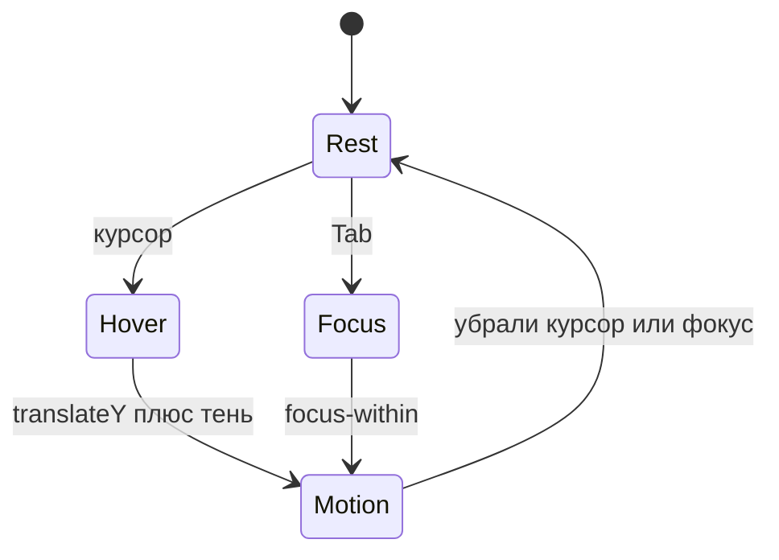

> **На уроке:** [runbook](./runbook.md) · [lecture](./lecture.md) · [slides](./slides.md) · [checks](./checks.md). Это deep-notes для подготовки.
# Урок A05. Витрина карточек и микро-интерактив

- Блок: A · 120 мин
- Стенд: [PulseDeck a05](../demo/)
- Радио: [starter](../student/starter/) → [etalon](../solution/) → почти готово к родителям

## Цель

Три карточки с `flex-wrap` и `gap`; hover/focus за ~200ms; `transition` только на нужные свойства; заготовка витрины для showcase.

## Два экрана

| PulseDeck | Pulse FM |
| --- | --- |
| Полка из трёх **игр**, зелёный неон | Три **трека**, фиолетовый неон |

## Тайминг 120

| Мин | Блок |
| --- | --- |
| 0–10 | Хук: мёртвая иконка в сторе |
| 10–28 | Схема состояний UI + transition |
| 28–55 | Полка игр вместе |
| 55–105 | Три трека в радио + проверка 360px |
| 105–120 | Смотр «к завтрашним родителям» |

---

## 1. Хук · 0–10

**Показать:** любая плитка в сторе / Spotify с hover (или эталон a05).

**Сказать:**

> Иконка без отклика кажется мёртвой. Мозг ждёт реакцию примерно за 200 миллисекунд — не ноль и не полсекунды. Сегодня плитки **отвечают**. Без JavaScript: браузер сам знает hover и focus. Завтра на showcase родители должны увидеть живое радио, не школьный реферат.

---

## 2. Презентация · состояния · 10–22



**Таблица affordance (на доске):**

| Состояние | Кто включает | Что делаем мы |
| --- | --- | --- |
| rest | по умолчанию | спокойная плитка |
| `:hover` | мышь | -4px + неон |
| `:focus-visible` / `:focus-within` | клавиатура | тот же отклик |
| `:active` | нажатие | опционально чуть сильнее |

### Transition: правильно и неправильно

```css
/* плохо: анимируется всё подряд, дёргается layout */
transition: all 0.2s;

/* хорошо */
transition: transform 0.2s ease, box-shadow 0.2s ease;
```

**Сказать:** `transform` и `opacity` дешёвые для браузера; анимировать `margin`/`width` — дороже и рывками.

`flex-wrap` + `gap`: не влезло — следующая полка (схема «полка магазина»).

`prefers-reduced-motion: reduce` — выключить transition. Не укачивать одноклассников.

---

## 3. Индустрия · UX · 22–26

**Сказать:**

> Affordance — подсказка «это можно нажать». Steam, Epic, Spotify поднимают плитку тенью и сдвигом. Это UX-паттерн, не украшение. Если интерфейс молчит 1 секунду — пользователь думает, что зависло. 200ms — зона «живой продукт». Focus для клавиатуры — доступность: не все играют мышью; так же тестируют продукты в больших компаниях.

---

## 4. Аналогия · 26–27

Платформер: персонаж приседает перед прыжком (anticipation) = hover.  
Python: не цикл, а правило «когда курсор над» ≈ декоратор по обстоятельству.

---

## 5. Ловушка · 27–28

> Только `:hover`, без focus. Человек на Tab увидит отклик?

**Нет.** Нужен `:focus-visible` или `:focus-within` на карточке. Иначе клуб только для «мышиных рыцарей».

---

## 6. Пример вместе · PulseDeck a05 · 28–55

### Шаг 1 · Разметка полки

```html
<div class="shelf">
  <article class="tile">...</article>
  <!-- три плитки -->
</div>
```

### Шаг 2 · Wrap

```css
.shelf {
  display: flex;
  flex-wrap: wrap;
  gap: 16px;
}
.tile {
  flex: 1 1 180px;
  max-width: 240px;
  /* padding, background, radius — уже знакомы */
}
```

**Показать DevTools device toolbar 360px:** плитки переносятся.  
**Сказать:** «Завтра родители могут смотреть с телефона — проверьте ширину сегодня.»

### Шаг 3 · Motion

```css
.tile {
  transition: transform 0.2s ease, box-shadow 0.2s ease;
}
.tile:hover,
.tile:focus-within {
  transform: translateY(-4px);
  box-shadow: 0 0 0 1px #2ee6a6, 0 16px 32px rgba(46, 230, 166, 0.2);
}
```

**Сделать:** внутри плитки ссылка `Play`, чтобы Tab реально заходил в focus-within.  
**Спросить:** «Почему ссылка внутри, а не tabindex на article?» → Проще и семантичнее для начала.

### Шаг 4 · Reduced motion

```css
@media (prefers-reduced-motion: reduce) {
  .tile { transition: none; }
}
```

**Показать:** эталон `a05/`.

---

## 7. Мост

| Стенд | Радио |
| --- | --- |
| `.shelf` / `.tile` | `.row` / `.card` |
| Зелёный glow | Фиолетовый `#7c5cff` |
| Игры Night Circuit… | Свои названия треков |
| Play | «Открыть» |

**Реплика:** «Это уже почти то, что увидят родители. Доведите до трёх разных треков.»

---

## 8. Лаборатория · 55–105

**Must-have:** 3 разных трека; wrap+gap; hover+focus; transition не `all`; шапка A04 жива; проверка ~360px без критичного вылета.

**Nice-to-have:** `flex: 1 1 200px`.

**Чёллендж:** `.btn:hover { transform: scale(1.04); }` + reduced-motion на кнопку.

---

## 9. Ошибки

| Симптом | Фикс |
| --- | --- |
| `transition: all` | Только transform и shadow |
| Hover только на img | На `.card` |
| Три одинаковых текста | Разные названия |
| Класс `.tile` в FM | Переименовать в `.card` |
| Нет Tab-отклика | Ссылка внутри + focus-within |

---

## 10. Смотр

«Покажи hover. Покажи Tab.» Напоминание про A06.  
ДЗ: [homework.md](homework.md) — добить витрину к demo day.


