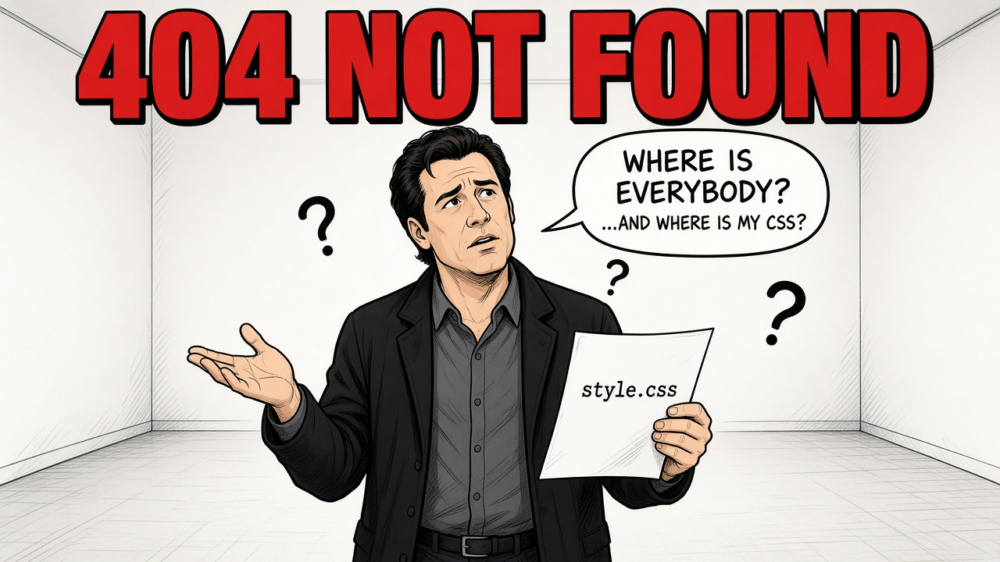

# A08 Слайды (проектор)

---

# PulseLab · Урок 8
## Шаблоны и статика: переезд сайта на сервер 🚀
Группа смотрит **на стену**

---

# Вспомним прошлое! 🧠
На прошлом уроке наш сервер делал вот так: 
`return "<h1>PulseLab жив</h1>"`

**Вопросы на засыпку:**
1. Кто превратил эти теги в красивый заголовок?
2. А что если нам нужно вернуть сайт на 500 строк кода? Удобно ли это писать в одной строке?

---

# Хьюстон, у нас проблема 🚨
Писать HTML внутри Python — это боль!


- **Ломаются кавычки** (один `class="card"` и всё взрывается 💥)
- **Нет подсветки HTML** (всё сливается в один цвет)
- **Полный хаос** (код и дизайн перемешаны в кашу)

**Решение:** Разделяй и властвуй! Код отдельно, верстка отдельно.

---

# Идеальный порядок папок 📁
У Flask есть строгие правила, где что должно лежать:

```text
my_site/
  app.py            🐍 <- Мозг (логика на Python)
  templates/        📄 <- Лицо (HTML-шаблоны)
    index.html
  static/           🎨 <- Одежда (стили, картинки, звуки)
    css/styles.css
    img/cover.svg
```
*(Спойлер: назовешь папку `template` без `s` — всё сломается!)*

---

# render_template() 🪄
Как сказать Питону отдать HTML-файл? Используем магию Flask:

```python
from flask import Flask, render_template

app = Flask(__name__)

@app.route("/")
def home():
    return render_template("index.html")
```

Flask сам пойдет в папку `templates/` и найдет там `index.html`. Умно, да? 😎

---

# Знакомьтесь: Jinja2 🥷
Движок, который читает шаблоны, называется **Jinja2**.


Он берет ваш HTML и может вставлять в него данные прямо из Python перед тем, как отдать браузеру! 
*(Кстати, Jinja по-японски — «храм» ⛩️)*

---

# Ловушка: "Где мои стили?!" 😱
Если написать в HTML по старинке:
`<link rel="stylesheet" href="style.css">`



- На главной `/` браузер запросит `/style.css` (И получит 404 Not Found!)
- На странице `/item/track` браузер запросит `/item/style.css` (Опять 404!)

**Вывод:** Статическим файлам нужен надежный GPS-навигатор! 🧭

---

# url_for спешит на помощь! 🦸‍♂️
Flask умеет сам строить правильные пути к файлам из папки `static/`:

```html
<!-- Подключаем стили как профи -->
<link rel="stylesheet" href="{{ url_for('static', filename='css/styles.css') }}">

<!-- Подключаем картинку -->

```

**Главное правило:** `filename` — это путь **внутри** папки `static/`. Не пиши слово static дважды! 🚫

---

# Сеть под микроскопом 🔬
Один клик по ссылке — это целая очередь HTTP-запросов:
1. `GET /` -> `200 OK` (Ура, приехал HTML!)
2. `GET /static/css/styles.css` -> `200 OK` (Подъехали стили 🎨)
3. `GET /static/img/cover.svg` -> `200 OK` (Картинка на месте 🖼️)

Открой **DevTools -> Network (Сеть)**: все полоски должны быть зелеными! 🟢

---

# Checkpoint 🎯
Давайте проверим, кто не спал:
1. В какую папку Flask смотрит, когда видит `render_template`?
2. Что подставит Flask вместо `{{ url_for('static', filename='css/styles.css') }}`?
3. Почему нельзя писать `filename='static/css/styles.css'`?

---

# Практика: You do 💻
**Миссия: Переезд на сервер!**
- [ ] Создай папки `templates/` и `static/` (внутри `static` сделай `css` и `img`).
- [ ] В `app.py` отдай `index.html` через `render_template`.
- [ ] Все стили и картинки подключи через `url_for('static', ...)`.
- [ ] Адрес в браузере должен быть `http://127.0.0.1:5000/` (никаких `file://`!).
- [ ] В DevTools -> Network нет красных ошибок 404.

---

# Exit ticket 🎟️
1. **Термины дня:** `render_template` и `url_for`.
2. **Задание:** Скинь скриншот своего работающего сайта на `127.0.0.1:5000` в чат группы! 📸
3. **Прогноз на будущее:** Как думаете, как завтра мы уберем копипасту 10 одинаковых карточек из HTML? 🤔
